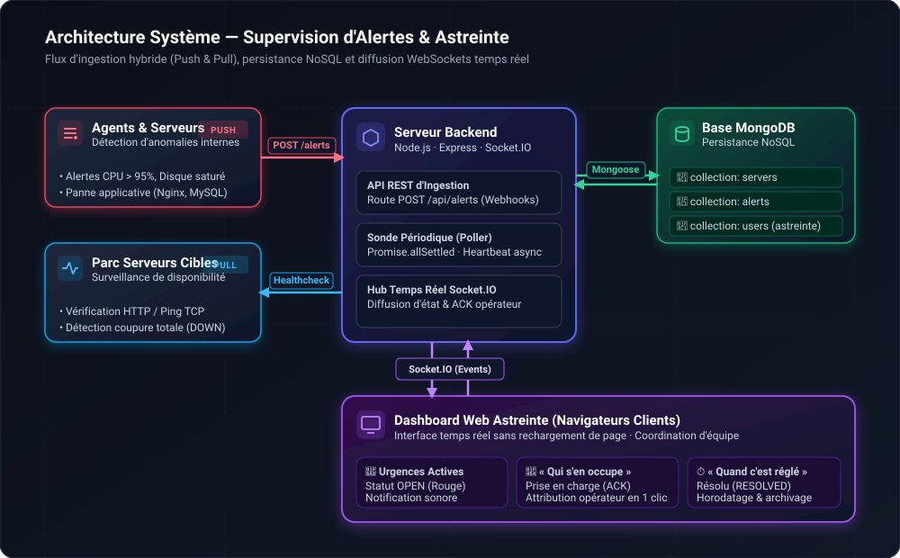

# Spécifications Techniques & Architecture

Ce document décrit l'architecture technique, les schémas de données NoSQL, les contrats d'API, les événements Socket.IO et la structure de l'application Next.js TypeScript.

---

## 1. Architecture Système



<details>
<summary>📐 Voir le diagramme sous format textuel (Mermaid)</summary>

```mermaid
flowchart TD
    subgraph Sources["Sources d'Alertes & Parc Informatique"]
        Agent["🖥️ Agents / Serveurs Distants<br/>(Pannes internes, CPU, Disque)"]
        Parc["🌐 Serveurs Surveillés<br/>(Disponibilité réseau)"]
    end

    subgraph Backend["Serveur Backend Node.js (server.js)"]
        CustomServer["⚙️ Serveur HTTP Node.js (http.createServer)"]
        NextCore["▲ Next.js App Router (RSC + API Routes)"]
        Poller["⏱️ Sonde Périodique (Boucle séquentielle 5 min)"]
        SocketHub["⚡ Hub Événements Socket.IO (Singleton global)"]
    end

    subgraph Database["Base NoSQL MongoDB"]
        MServers[("📁 servers")]
        MAlerts[("📁 alerts")]
        MUsers[("📁 users")]
    end

    subgraph Frontend["Dashboard Astreinte Next.js (React)"]
        RSC["🖥️ Server Components (Rendu initial SSR)"]
        ClientAlerts["🚨 AlertList ('use client' + Socket.IO)"]
        ClientHistory["📜 Onglet Historique & Post-mortem"]
        ServerForm["➕ Formulaire d'ajout serveur"]
    end

    Agent -->|POST /api/alerts (Push)| NextCore
    Poller -.->|Ping HTTP toutes les 5 min (Pull)| Parc
    Parc -.->|Réponse / Timeout| Poller

    NextCore --> MAlerts
    Poller --> MServers
    Poller -->|Création immédiate alerte si DOWN| MAlerts

    CustomServer --> SocketHub
    NextCore -->|getIO.emit| SocketHub
    Poller -->|getIO.emit| SocketHub
    SocketHub <==>|WebSockets bidirectionnels| ClientAlerts
```

</details>

---

## 2. Le Pont Next.js ↔ Socket.IO (`server.js` & Singleton)

### 2.1 Fonctionnement sous le capot
Next.js en mode standard gère ses requêtes HTTP de façon isolée. Pour lui greffer des WebSockets persistants sans monter deux serveurs distincts :
1. **`server.js` (Point d'entrée Node.js) :**
   - Crée un serveur HTTP Node standard : `const server = http.createServer(...)`.
   - Initialise Socket.IO sur ce serveur : `const io = new Server(server)`.
   - Initialise Next.js : `const app = next({ dev })` et lui délègue toutes les requêtes HTTP entrantes via `app.getRequestHandler()`.
   - Enregistre l'instance `io` dans un singleton partagé (`setIO(io)`).
2. **`lib/socket.ts` (Singleton) :**
   - Expose une fonction `getIO()` accessible partout dans le backend (Route Handlers, sonde poller).
3. **Dans les Route Handlers Next.js (`src/app/api/...`) :**
   - Quand une requête arrive (ex: `POST /api/alerts`), la route traite l'écriture en base, puis appelle `getIO().emit('alert:new', alert)` pour notifier instantanément tous les navigateurs connectés.

---

## 3. Modèles de Données & Types TypeScript (MongoDB / Mongoose)

### 3.1 Types TypeScript

```typescript
// types/server.ts
export interface IServer {
  _id: string;
  name: string;
  host: string;
  port: number;
  healthUrl?: string; // URL spécifique pour le check HTTP (ex: /health)
  description?: string;
  status: 'UP' | 'DOWN' | 'UNKNOWN';
  latencyMs?: number;
  lastCheckAt?: Date;
  createdAt: Date;
  updatedAt: Date;
}

// types/alert.ts
export type AlertSeverity = 'INFO' | 'WARNING' | 'CRITICAL';
export type AlertStatus = 'OPEN' | 'ACK' | 'RESOLVED';

export interface IAlert {
  _id: string;
  serverId?: string; // Référence IServer (optionnelle si alerte orpheline)
  serverName: string;
  title: string;
  message: string;
  severity: AlertSeverity;
  status: AlertStatus;
  assignedTo?: string; // Nom de l'opérateur d'astreinte
  acknowledgedAt?: Date;
  resolvedAt?: Date;
  resolutionComment?: string; // Commentaire non obligatoire de clôture
  transferredFrom?: string[]; // Historique des délégations
  createdAt: Date;
  updatedAt: Date;
}

// types/user.ts
export interface IUser {
  _id: string;
  name: string;
  email: string;
  phone?: string;
  role: 'ASTREINTE' | 'ADMIN';
  isOnDuty: boolean;
}
```

---

## 4. Workflow Métier de l'Astreinte & Concurrence

### 4.1 Prise en charge à la milliseconde sans popup (Option A : Hybride REST + Broadcast)
1. L'utilisateur clique sur *« Prendre en charge »*.
2. Le composant client envoie une requête `PATCH /api/alerts/[id]` avec `{ action: 'ACK', operator: 'Théo' }`.
3. **Opération conditionnelle atomique MongoDB :**
   ```typescript
   const updatedAlert = await Alert.findOneAndUpdate(
     { _id: alertId, status: 'OPEN' }, // Condition stricte : seul le 1er gagne
     { 
       $set: { 
         status: 'ACK', 
         assignedTo: operatorName, 
         acknowledgedAt: new Date() 
       } 
     },
     { new: true }
   );
   ```
4. **Diffusion Socket.IO :**
   - Si succès, le backend diffuse `getIO().emit('alert:updated', updatedAlert)`.
   - Tous les clients voient immédiatement la carte passer en *« Pris par Théo »*.
   - **Pas de popup ni de modale :** le perdant voit simplement le ticket se mettre à jour avec le nom du collègue sans interruption.

### 4.2 Règle de transfert de ticket
- Un tiers ne peut pas s'approprier un ticket en cours.
- Seul le technicien détenteur (`assignedTo === currentOperator`) peut transférer l'alerte à un autre intervenant via un sélecteur *« Passer la main »*.

### 4.3 Résolution & Archivage
- Bouton *« Résoudre »* avec champ de commentaire de résolution **optionnel**.
- L'alerte passe en `RESOLVED` et quitte la liste active pour rejoindre automatiquement l'**Onglet Historique / Post-mortem**.

---

## 5. La Sonde Périodique (Moteur Poller)

### 5.1 Caractéristiques de la Sonde
- **Fréquence globale :** Toutes les **5 minutes** (300 000 ms).
- **Mode d'exécution :** Séquentiel pas-à-pas avec notification immédiate.
  - La sonde prend la liste des serveurs configurés en base.
  - Elle teste le serveur $N$ via son URL de healthcheck avec timeout de 3 secondes.
  - **Résultat immédiat :**
    - Si `OK` : statut mis à jour en `UP` avec temps de latence.
    - Si `KO` (Timeout / Erreur 5xx / Inaccessible) : **Alerte immédiate au premier échec**.
      - Mise à jour du statut serveur en `DOWN`.
      - Création immédiate d'une alerte `CRITICAL` en base : *« Serveur [Nom] injoignable »*.
      - Émission immédiate de l'événement Socket.IO `alert:new` et `server:status_change`.
  - La sonde passe immédiatement au serveur suivant ($N+1$).

---

## 6. Gestion du Parc Serveurs

1. **Ajout via le Dashboard exclusivement :**
   - Formulaire dédié sur l'interface (Nom, IP/Hôte, Port, URL de healthcheck, Description).
   - Pas de pré-chargement obligatoire par seed.
2. **Fiche détaillée du serveur :**
   - Données temps réel : état (`UP`/`DOWN`), latence en ms, date du dernier check.
   - **Historique lié :** Liste de tous les tickets passés et présents associés à ce serveur.

---

## 7. Architecture de Code Next.js (TypeScript)

```
app/
├── server.js                      # Serveur Node.js custom (Next.js + Socket.IO + Poller)
├── package.json                   # Dépendances Next.js, React, Socket.IO, Mongoose
├── tsconfig.json                  # Configuration TypeScript
├── next.config.mjs                # Configuration Next.js
│
├── src/
│   ├── app/                       # App Router (Next.js 14+)
│   │   ├── layout.tsx             # Layout global (Navbar, Bannière d'alerte)
│   │   ├── page.tsx               # Dashboard principal (RSC initial + Client AlertList)
│   │   ├── history/page.tsx       # Onglet Historique & Post-mortem
│   │   ├── servers/page.tsx       # Gestion du parc et formulaire d'ajout
│   │   ├── servers/[id]/page.tsx  # Fiche serveur avec historique de ses tickets
│   │   └── api/                   # Route Handlers REST
│   │       ├── alerts/route.ts    # GET (actives) / POST (push webhook)
│   │       ├── alerts/[id]/route.ts # PATCH (ACK atomique, RESOLVE, TRANSFER)
│   │       └── servers/route.ts   # GET / POST (création serveur)
│   │
│   ├── components/                # Composants (PascalCase, RSC par défaut)
│   │   ├── alerts/
│   │   │   ├── AlertCard.tsx      # Carte d'alerte interactive ('use client')
│   │   │   └── AlertList.tsx      # Liste temps réel synchronisée ('use client')
│   │   ├── servers/
│   │   │   ├── ServerCard.tsx     # Statut UP/DOWN et latence
│   │   │   └── AddServerForm.tsx  # Formulaire d'ajout
│   │   └── layout/
│   │       ├── Header.tsx         # Navbar, profil opérateur connecté et bouton Déconnexion
│   │       └── Navigation.tsx     # Onglets Actives / Historique / Serveurs (masqué sur /login)
│   │
│   ├── hooks/                     # Custom Hooks React
│   │   ├── useSocket.ts           # Connexion et écouteurs Socket.IO
│   │   └── useOperator.ts         # Profil opérateur connecté & déconnexion
│   │
│   ├── lib/                       # Singletons & Utilitaires backend
│   │   ├── auth.ts                # Hash scrypt et ré-export de session
│   │   ├── session.ts             # Jeton HMAC SHA-256 (Web Standards, Edge-compatible)
│   │   ├── seed.ts                # Amorçage idempotent des 2 opérateurs par défaut
│   │   ├── db.ts                  # Connexion Mongoose (cached connection)
│   │   ├── socket.ts              # Singleton getIO() / setIO()
│   │   └── poller.ts              # Boucle de sonde séquentielle (5 min)
│   │
│   ├── middleware.ts              # Protection des routes et redirection /login
│   │
│   ├── models/                    # Schémas Mongoose
│   │   ├── Alert.ts
│   │   ├── Server.ts
│   │   └── User.ts                # Champ password sécurisé (select: false)
│   │
│   └── types/                     # Interfaces TypeScript
│       ├── alert.ts
│       ├── server.ts
│       └── user.ts                # IUser, UserRole, ISessionPayload
```

---

## 8. Authentification & Contrôle d'Accès (ADR-0008)

1. **Identification par Formulaire (`/login`) :**
   - Accès nominal par identifiant (Nom ou Email) et mot de passe.
   - Mot de passe par défaut : `admin`.
   - Cookie de session HttpOnly `supervis_session` signé via HMAC-SHA256 (Web Standards).
2. **Protection des Routes (`middleware.ts`) :**
   - Redirection automatique vers `/login` pour tout accès non authentifié aux pages de supervision (`/`, `/history`, `/servers`).
   - Réponses `401 Unauthorized` pour les appels API protégés sans session.
   - Exemptions publiques : `/login`, `/api/auth/*`, `/api/health`, `/api/poller`.
3. **Verrouillage de l'Inscription Libre :**
   - `POST /api/users` retourne systématiquement `403 Forbidden`.
   - Seuls les opérateurs d'astreinte pré-configurés (`Théo` ADMIN, `Sarah` ASTREINTE) ont accès à l'outil.
